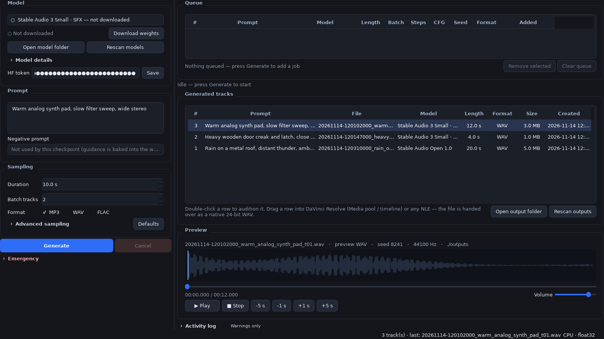

# Simple Sound Generator — Stable Audio Desktop

A standalone, portable desktop app for generating **background music** or
**sound effects** with Stable Audio, in a single self-contained folder. No
installer, no admin rights, no PATH changes: `run.bat` / `run.sh` bootstraps
everything the first time and caches it locally.



**[Download the latest release](https://github.com/cblinde/SimpleSoundGenerator/releases/latest)**
— unzip it and run `run.bat` (Windows) or `./run.sh` (macOS/Linux); the launcher
builds its own Python environment and fetches the weights on first use. This
repository holds the source, the portable build script and the GitHub Actions
workflow that renders the screenshot above and attaches the zip to each release.

## Prerequisites

| Requirement | Needed for | Notes |
|---|---|---|
| Windows 10/11, macOS or Linux, 64-bit | everything | Tested on Windows 11 |
| ~5 GB free disk (plus 3.5–10.4 GB per model) | bootstrap + weights | `.venv` alone is ~2.5 GB with CUDA PyTorch |
| Python 3.10–3.13 | — | **Optional.** `run.bat` finds one or downloads a portable copy; you never install or activate anything by hand |
| NVIDIA GPU with 6 GB+ VRAM | fast generation | Optional. CUDA when `nvidia-smi` works and CUDA really initialises, otherwise CPU; Stable Audio 3 Small is usable on CPU |
| NVIDIA GPU, Ampere or newer (RTX 30xx+) | FlashAttention 2, SA3 Medium | Optional; older cards and CPU simply skip it |
| Free Hugging Face account + read token | **downloading gated weights** | Not needed to start the app, play existing tracks or run a model already in `config/models` |
| Internet access | first bootstrap + weight downloads | Everything is cached under `config/models` afterwards |

### Getting a Hugging Face token

Every Stability AI audio repository is gated: the files exist, but Hugging Face
only hands them out to accounts that accepted the licence for that specific
repository. That is why a download without a token fails with
`401` / `You are trying to access a gated repo` even though the URL works in a
browser.

1. **Create an account** at <https://huggingface.co/join> and confirm the email.
2. **Accept the licence of each repository you want to use.** Open the model
   page while signed in and press the access/terms button:
   * Stable Audio Open 1.0 — <https://huggingface.co/stabilityai/stable-audio-open-1.0>
   * SA3 Small · Music — <https://huggingface.co/stabilityai/stable-audio-3-small-music>
   * SA3 Small · SFX — <https://huggingface.co/stabilityai/stable-audio-3-small-sfx>
   * SA3 Medium — <https://huggingface.co/stabilityai/stable-audio-3-medium>

   Approval is normally instant, but some licences are reviewed manually — if the
   page still shows the gate, the download will keep failing no matter how good
   the token is.
3. **Create a read token**: <https://huggingface.co/settings/tokens> →
   *New token* → type **Read** (a fine-grained token needs `read` access to the
   gated repositories; no write scope is required). Copy it — it is shown once.
4. **Paste it into the app**: *Model* panel → **HF token** field → **Save** (or
   just press Generate; the field is written on every generation). The field is
   outlined red while empty because gated downloads cannot work without it.
5. **What happens to it**: it is stored in `config/.hf_token` (inside the app folder,
   never logged, never shown again) and exported to the process as `HF_TOKEN` /
   `HUGGING_FACE_HUB_TOKEN`, so the downloader *and* the Stable Audio 3 runtime
   (whose text encoder is loaded by `transformers`) both authenticate.
6. **Headless / CI**: skip the field and export the variable yourself instead —
   `set HF_TOKEN=hf_...` on Windows, `export HF_TOKEN=hf_...` on macOS/Linux.
   The app reads the variable first and only falls back to `config/.hf_token`.

Tokens can be revoked at any time on the same settings page; removing the value
from the field and pressing **Save** deletes `config/.hf_token` and unsets the
environment variables for that session. Treat the token like a password: do not
commit `config/.hf_token`, and rotate it if it ever ends up in a screenshot, a log
paste or a chat message.

## Quick start

**Windows**

```bat
run.bat
```

**macOS / Linux**

```bash
./run.sh
```

First run only (a few GB of downloads):

1. finds a usable Python 3.10–3.13 — or downloads
   [python-build-standalone](https://github.com/astral-sh/python-build-standalone)
   CPython 3.12.16 into `./.python/` (works for Windows x64/ARM64, Linux
   x64/ARM64 and macOS Intel/Apple Silicon);
2. creates `./.venv` with that interpreter;
3. installs PyTorch 2.7.1 + torchaudio for the detected hardware — from `cu128`
   then `cu126` when `nvidia-smi` works and CUDA actually initialises, otherwise
   the CPU wheel — then `code/requirements.txt` and the optional Stable Audio 3
   runtime;
4. launches `code/app.py`.

No git executable and no preinstalled Python are required: the optional Stable
Audio 3 runtime is installed from a GitHub source archive rather than a `git+`
URL, so a clean Windows machine with only the folder can complete the install.

`run.bat --setup-only` (or `./run.sh --setup-only`) prepares the environment and
exits — handy for provisioning a machine or a build pipeline.

The first run is recorded in `./logs/bootstrap.log` even when the console closes:
interpreter and `.venv` decisions, the CUDA/CPU choice, pip's own detailed install
log, and whether the launch succeeded. If the window never appears, inspect that
file instead of relying on the vanished console.

Once the UI is up, `run.bat` closes its console window, so the app behaves like
a normal desktop program: the GUI is started through `pythonw.exe`, which owns no
console and therefore cannot be killed by that window closing. Everything the
app prints still lands in `./logs/app.log`; the bootstrap's own decisions and pip's
detailed install log are appended to `./logs/bootstrap.log`.

When you *do* want the console — a startup traceback, or `print`-style
debugging — start it with:

```bat
run.bat --debug
```

That keeps the window open and runs the app in the foreground. The launcher also
falls back to console mode by itself if `pythonw.exe` is missing or `PySide6`
refuses to import, so a broken environment is never hidden behind a vanishing
window. On macOS/Linux there is no console window to hide, so `./run.sh` always
runs in the foreground and accepts `--debug` for symmetry.

## Command-line reference

| Command | Effect |
|---|---|
| `run.bat` / `./run.sh` | bootstrap if needed, then launch (console window closes on Windows) |
| `run.bat --debug` / `./run.sh --debug` | launch in the foreground with the console attached |
| `run.bat --setup-only` / `./run.sh --setup-only` | prepare `.python`, `.venv`, PyTorch, requirements and the SA3 runtime, then exit |
| `run.bat --flash-attn` / `./run.sh --flash-attn` | retry the optional FlashAttention 2 wheel |
| `run.bat --no-flash-attn` / `./run.sh --no-flash-attn` | skip FlashAttention 2 for this launch |
| `run.bat --repair` / `./run.sh --repair` | force the full dependency check (pip, PyTorch, SA3 runtime, FlashAttention) |
| `run.bat --help` / `./run.sh --help` | print the launcher usage |
| `run.bat --version` / `./run.sh --version` | print the app version and exit — no venv check, no downloads (`python code/app.py --version` works too) |
| `python code/flash_attn_setup.py --check` | report whether FlashAttention 2 is installed and usable |
| `python code/flash_attn_setup.py --dry-run --simulate "cu128 torch2.7.1 cp311 win_amd64"` | show which wheel would be installed, without touching the environment |
| `python code/flash_attn_setup.py --force` | ignore the recorded failure and try again |

Unknown arguments are passed through to `code/app.py`, which forwards them to Qt.

Repeat launches skip pip entirely. After a successful setup the launcher stores a
copy of `code/requirements.txt` in `.venv/.deps-req`; while that copy still matches and
the packages resolve it goes straight to the window. That removes roughly two
minutes of pip resolver work and a source-archive fetch of the Stable Audio 3
runtime per start — on a representative Windows machine 6 s of `pip install -r`,
122 s of the Stable Audio 3 source install and 15 s of FlashAttention probing.
`--repair`, an edited `code/requirements.txt`, or a missing package all bring the full
check back.

Every start also writes a single line to `logs/app.log`, e.g.
`startup: 1144 ms total = import 762 (bootstrap 5, qt 658, deps 57, code 42) + qapp 46 + window 317 + show 18`,
so a launch that felt slow can be diagnosed afterwards instead of guessed at.

Model loads and every generated track write the same kind of single line, which
separates loading from sampling from saving:

```
load: 12.41 s = imports 1.83 + weights 9.92 + placement 0.61 + ready 0.05 (Stable Audio 3 Small · SFX · stable_audio_3 · cuda)
generation 1/3: 34.20 s = sampling 32.05 + save 2.15 | 3.74x realtime (120.0 s audio, seed 1234, cuda)
batch: 3/3 track(s) in 102.60 s = 34.20 s/track | 360.0 s audio | 3.51x realtime
```

The closing `batch:` line covers the whole run — tracks saved out of tracks
requested (a cancelled batch shows `2/5`), total wall time, average per track,
audio produced and the overall realtime factor.

`imports` is the runtime import (diffusers or `stable_audio_3`), `weights` the
checkpoint read and text encoder, `placement` the device move / offload setup.
On a track, `sampling` covers denoising plus decode and `save` covers every
requested encoder (MP3/WAV/FLAC), the waveform peaks and the JSON sidecar; `x realtime` is generated seconds per
wall second, so 3.74x means an 120 s clip took 32 s.

Everything stays in the app folder:

```
SimpleSoundGenerator/
├─ run.bat / run.sh        bootstrap: Python, .venv, requirements, launch
├─ code/
│  ├─ app.py               PySide6 GUI, player, drag-and-drop, workers
│  ├─ audio_engine.py      inference, device routing, batching, WAV export
│  ├─ model_manager.py     registry, local scanning, weight downloads
│  ├─ paths.py             portable paths, HF_HOME/TORCH_HOME, token export
│  ├─ flash_attn_setup.py  optional FlashAttention 2 wheel resolver/installer
│  └─ requirements.txt     dependency pins (torch/torchaudio 2.7.1 exactly)
├─ config/
│  ├─ models.json          editable model registry (per-model metadata)
│  ├─ models/              HF_HOME + TORCH_HOME + one folder per model
│  ├─ settings.ini         window geometry, controls, disclosure state
│  └─ .hf_token            HF token, if you entered one in the app
├─ outputs/                generated MP3/WAV/FLAC + JSON sidecar metadata
├─ logs/app.log            rotating application log
├─ logs/bootstrap.log      launcher/first-run log (pip details included)
├─ .python/                portable interpreter (created by the bootstrap)
└─ .venv/                  virtual environment (created by the bootstrap)
```

### Source layout

| File | Responsibility |
|---|---|
| `code/app.py` | Window, worker threads, queue, results table, player, logging, settings |
| `code/audio_engine.py` | Device selection, model loading, sampling, WAV/MP3/FLAC export, OOM recovery |
| `code/model_manager.py` | `config/models.json` registry, local folder discovery, weight downloads |
| `code/paths.py` | Portable paths, HF/Torch cache redirection, token export, logging paths |
| `code/flash_attn_setup.py` | Optional FlashAttention 2 wheel resolver, installer and smoke test |
| `config/models.json` | Editable registry: ids, repos, limits, default steps and guidance |
| `run.bat` / `run.sh` | Bootstrap the interpreter, `.venv`, PyTorch and the SA3 runtime, then launch |
| `_dev/build_delivery.py` | Dev-only staging + versioned zip builder (its output is never shipped inside the zip) |
| `_dev/screenshot.py` | Dev/CI-only offscreen renderer for `docs/screenshot.png` |
| `.github/workflows/release.yml` | CI: compile/validate, build the zip, render the screenshot, publish the release |
| `docs/screenshot.png` | Window image used by this README and attached to the release |

Documentation conventions: every non-trivial function and method carries a
docstring saying what it is responsible for, and comments are reserved for the
reason behind a decision — why a cancel pauses the queue, why saved widths are
checked against the current column count, why the model switch keeps a typed
duration. Pure Qt overrides and one-line properties are left undocumented on
purpose so the signal stays readable.

## Models

The dropdown is driven by `config/models.json` (shipped; edit it freely). Selecting a
model renders a description panel with architecture, target use case,
recommended sampling parameters, licence/gating notes and the **local storage
status**. Weights are always stored in `config/models/<model id>/`.

| Model | Architecture | Use case | Length | Weights |
|---|---|---|---|---|
| Stable Audio 3 Small · SFX | Stable Audio 3, SFX-specialised | one-shot transients, impacts, foley | ≤ 120 s | ~3.5 GB |
| Stable Audio 3 Small · Music | Stable Audio 3 (rectified-flow DiT + SAME-Small + T5Gemma) | music beds and loops, CPU friendly | ≤ 120 s | ~3.5 GB |
| Stable Audio 3 Medium | Stable Audio 3 (1.4B DiT + SAME-Large + T5Gemma) | long-form music, complex design | ≤ 380 s | ~10.4 GB |
| Stable Audio Open 1.0 | Stable Audio Open (latent DiT + T5), diffusers `StableAudioPipeline` | SFX, foley, loops, ambience, short cues | ≤ 47 s | ~4.4 GB |

The dropdown lists them in this order; the fastest model to try (Small · SFX) sits
first, the 47-second legacy model last. That order is presentation only: the model
preselected at startup is pinned by the `DEFAULT_MODEL_ID` constant in `code/app.py`
(`stable-audio-3-small-sfx`), so reordering `config/models.json` — or removing and
re-adding entries — never changes which checkpoint the window starts on. If that id
is missing from the registry, the first entry is used instead.

### Downloading weights

* **Download weights** in the Model panel fetches into `config/models/<id>/` with a
  live progress line, or generation does it automatically before loading.
* The dropdown states the local situation of every entry — `●` downloaded (with
  its size), `◐` partially downloaded, `○` not downloaded — and is re-stamped
  whenever a download finishes, is cancelled or fails.
* **Cancel** stops a download in progress. The bytes already received stay in
  the model folder (`*.incomplete`), so pressing **Download weights** again — or
  simply **Generate** — continues from that point; files that already completed
  are never fetched a second time.
* All Stability AI audio repos are **gated**: open the model page, accept the
  licence, create a read token at <https://huggingface.co/settings/tokens>, and
  paste it into the **HF token** field (stored in `config/.hf_token`, never logged).
* Folders you copy into `config/models` by hand are auto-discovered and appear as
  `<folder> (local)` — useful for converted checkpoints.

### Stable Audio 3 backend

The native SA3 checkpoints are **not** distributed in diffusers format, so the
engine uses Stability AI's official runtime. `run.bat` / `run.sh` install it
automatically as an optional step from the GitHub source archive, so git is not
required (`--no-deps`: it pins
`torch==2.7.1` itself), and a failure there only disables SA3 — it never blocks
a launch. Re-run the bootstrap after updating this app.

The runtime's `from_pretrained()` accepts registry keys only (`small-sfx`,
`medium` …) and re-resolves them through the Hub, so the app opens
`model.safetensors` + `model_config.json` straight from `config/models/<id>` instead:
a folder you downloaded or copied in loads with no second download. Weights load
as fp16 on CUDA and fp32 on CPU. Medium additionally expects CUDA and
FlashAttention 2 for its documented performance; the Small checkpoints run on CPU.

A **diffusers-format** SA3 folder (one with a `model_index.json`) loads through
diffusers `StableAudio3Pipeline`, which the pinned diffusers 0.42.1 already
ships — no extra runtime needed. The backend is chosen from `model_index.json`,
so both families coexist in the same dropdown.

### Adding your own model

Append to `config/models.json`:

```json
{
  "extra_models": [
    {
      "id": "my-sa3-converted",
      "name": "My SA3 (converted)",
      "repo_id": "",
      "architecture": "Stable Audio 3 (diffusers)",
      "backend": "diffusers",
      "use_case": "custom",
      "max_duration": 120.0,
      "sample_rate": 44100,
      "duration_arg": "duration",
      "default_steps": 8,
      "default_guidance": 1.0,
      "required_files": ["model_index.json"],
      "gated": false
    }
  ]
}
```

Then drop the checkpoint into `config/models/my-sa3-converted/` and press
**Rescan models**. `duration_arg` maps the Duration control onto the
pipeline's own kwarg (`audio_end_in_s` for Stable Audio Open,
`duration` for Stable Audio 3); unknown kwargs are filtered against the
pipeline signature at call time.

## Generation controls

Text prompt, negative prompt, duration, inference steps, guidance/CFG, random
seed and **Batch tracks** — the number of distinct tracks produced by one
request. A fixed seed produces `seed, seed+1, seed+2 …` across the batch; the
random-seed toggle draws a fresh seed per track. Each track is written into
`./outputs` with a JSON sidecar carrying prompt, model, seed, duration, device
and timing.

**Defaults**, next to the *Advanced sampling* toggle, puts duration, inference
steps and guidance back to what the selected checkpoint recommends (its
`default_steps` and `default_guidance`, with the 10 s default length capped by
`max_duration`). It leaves the prompt, seed, batch size and output formats
alone, so it is safe to press after experimenting with one parameter.

### Queue

**Generate** adds the current settings to the queue instead of doing nothing
while a batch is running: write the next prompt, press Generate, and the job
starts by itself when the one before it finishes. The queue sits directly above
the status line and the track list, and every waiting job shows its prompt,
model, length, **batch size** (`×4` means four tracks), steps, CFG, seed and
output formats — enough to check a long unattended run at a glance. The **Added**
column records the local time each job joined the queue, so a restored session
shows how long its waiting jobs have been sitting there; queues saved by older
builds show `—` for that column. Like the
track list, the queue's columns drag: widen the prompt to read it in full, and
the narrow settings columns keep their own widths.

**Remove selected** drops the highlighted job(s) and **Clear queue** drops every
waiting job; neither touches the job that is currently generating. Dragging a
row up or down moves that job in the running order — handy for pulling a short
one-off take ahead of a long prompt already queued — and the `#` column
renumbers to match. The new order is what gets saved, so it survives a restart.

After a batch finishes, the queue quotes an estimate beside its buttons —
`≈ 4 min 05 s for 9 waiting track(s)` — from that batch's measured seconds per
track. Model loading and weight downloads are excluded, the running job is not
counted, and a restored queue stays without an estimate until the next batch has
measured itself on this machine. Cancel and
failures pause the queue rather than silently throwing it away: the remaining
jobs stay listed and a **Resume queue** button starts them again, so one broken
job does not make the app chew through everything queued behind it.

The prompt and sampling controls stay editable the whole time — they describe
the *next* job, while the running one keeps the settings it was queued with.
Adding a job does not clear the prompt, so the same prompt can be queued twice
with different lengths or seeds.

Waiting jobs are written to `config/settings.ini` when the app closes and restored on
the next launch, **paused**: reopening never starts generating on its own, the
list waits behind **Resume queue**. The job that was running at close time is
not restored — its finished tracks are already in `./outputs`, so repeating it
would duplicate them.

### Factory reset

**Factory reset** lives inside the collapsed **Emergency** section at the bottom
of the left panel. The section always starts closed, so resetting takes a
deliberate expand followed by the button click; it collapses itself again after
a reset. Factory reset puts every preference back to its default: duration 10 s,
the selected model's inference steps and CFG, seed 42 with random seed on, two
tracks, MP3 as the only output, empty prompt and negative prompt, an empty queue,
built-in column widths for both tables, 85 % volume, device Auto, the details,
advanced-sampling and activity-log panels closed, and the Emergency section
collapsed. A confirmation asks first, and the button's tooltip lists the same
effects before you press it.

It resets preferences only. Tracks in `./outputs`, the model weights in
`config/models` and the HF token are kept, and a batch that is already generating
keeps running — clearing the queue only removes the jobs waiting behind it.

### Output formats

**Format** has one checkbox per output type. Tick any combination — every ticked
format is rendered once and encoded from the same normalized buffer, so the
files share a stem and an identical level. **MP3 is ticked by default**, and at
least one box must stay ticked: unticking the last one is refused and the box
comes back on.

| Format | Written as | 3 min clip | When to use it |
|---|---|---|---|
| MP3 | 320 kbps CBR, LAME quality 0 (slowest, best) | ~7 MB | editing, previews, sharing |
| WAV | 24-bit PCM | ~31 MB | further processing, mastering |
| FLAC | 24-bit lossless | ~16 MB | lossless archive, half the size |

A track stays **one row** no matter how many formats were written: the
**Format** column lists them best-first (`WAV + FLAC + MP3`) and its tooltip
shows each file's size. **Preview** always plays the best-quality file that
exists — WAV, then FLAC, then MP3 — and the preview line names the format in use
(`preview WAV (best of WAV/FLAC/MP3)`), so what you hear is never a lossy copy
while a lossless sibling is present. Deleting one format leaves the row intact
as long as another remains.

When the files behind a row are gone (deleted or moved out of `./outputs`) or Qt
cannot decode the one it picked, the **Preview** box says so in amber —
`Cannot preview track.wav — the file is missing (moved or deleted).` — clears the
waveform and disables Play until you select a track that can be played, instead
of silently leaving the previous track's name on screen. The detail from the
backend goes to `logs/app.log`.

320 kbps is the highest bitrate MPEG-1 Layer III defines at 44.1 kHz and quality
0 is LAME's most thorough search, so this is the best MP3 the format allows. MP3
encoding uses `lameenc` (LAME bindings), which is **LGPL-3.0 — the same license
as the PySide6 UI**, and the MP3 patents expired in 2017, so it does not change
what you may do with the app. FLAC uses the `soundfile`/libsndfile pair already
shipped. If `lameenc` is missing (an older `.venv`), a batch with MP3 ticked
reports that and asks you to re-run the bootstrap rather than writing nothing.

## Player and export

The track list shows the prompt, the written **File** name, the model, length,
format, size and creation time. The File column sits immediately right of the
prompt, so a row can be matched to the name in `./outputs` at a glance. Every
column divider drags: widen the prompt or file column to read a long entry in
full, and the text is elided at the current width rather than truncated. Both
this table's widths and the queue's are stored in `config/settings.ini`, so they come back at the next launch; a saved row from a build with a different column set is
ignored rather than applied to the wrong columns.

The **Activity log** below the player folds down to a single header when it is not
being read, giving that height back to the track list; click the header to expand
it. The collapsed state is stored in `config/settings.ini`, so it opens the way it was
left, and lines are still recorded while it is hidden — expanding it later shows
what happened in between. **Warnings only**, in the same header, hides INFO lines
and keeps warnings and errors, so a busy run can be read at a glance. It filters
the panel only: `logs/app.log` still records every line, and unticking it brings
the hidden INFO lines back (the panel keeps its own copy of the history). The
filter is stored in `config/settings.ini` like the collapsed state, and Factory reset
turns it off.

* Play/Pause, Stop, ±1 s and ±5 s seek buttons.
* Scrubbing slider with a 10 ms arrow-key step, plus a click/drag waveform with
  a playback head.
* Result table shows prompt, model, length, file size and timestamp. **The most
  recently generated track is always the top row**, so a running batch fills the
  list downwards; existing tracks from previous sessions are reloaded on launch
  in the same newest-first order.
* **Drag any row into DaVinci Resolve** (Media pool or timeline) or another NLE.
  Rows are exported as native file handles via `text/uri-list`, pointing at the
  real 24-bit WAV on disk — no conversion step.

## Output files and file names

Each track is written to `./outputs` as 24-bit PCM WAV (44.1 kHz stereo for
every model in the registry) next to a JSON sidecar with the same stem:

```
20261106-095046_warm-analog-synth-pad-slow-att.mp3       ← MP3 alone (the default)
20261106-095046_warm-analog-synth-pad-slow-att.wav       ← same track, WAV also ticked
20261106-095046_warm-analog-synth-pad-slow-att.json
20261106-095046_warm-analog-synth-pad-slow-att_t02.mp3   ← second track of a batch
```

* `YYYYMMDD-HHMMSSmmm` — local time to the millisecond, so a folder sort is
  chronological.
* The middle part is the first **30 characters of the prompt**, lowercased and
  reduced to `a–z`, `0–9`, `-` and `_`. Spaces, punctuation, quotes, slashes,
  accents and emoji collapse into single dashes (`Café — "jazz" / noir` →
  `caf-jazz-noir`), a blank prompt becomes `track`, and Windows device names
  (`con`, `nul`, `com1` …) get `-audio` appended.
* `_tNN` only appears for multi-track batches.
* If a name is already taken — same prompt, same millisecond — `-2`, `-3` … is
  appended, so nothing is ever overwritten.

The sidecar `*.json` carries `filename`, `prompt`, `negative_prompt`, `model_id`,
`model_name`, `seed`, `duration_s`, `sample_rate`, `channels`, `size_bytes`,
`created`, `device`, `elapsed_s`, `files` (one entry per written format) and a
`peaks` array used to redraw the waveform without re-reading the audio. Only the bare file name is recorded, never an
absolute path, so `./outputs` can travel with the application folder: the row is
resolved against the folder the sidecar lives in. Sidecars written by older
versions (which stored `path`) still load — the absolute path is used while it
exists, otherwise its file name is looked up beside the sidecar, so even tracks
generated before a move reappear. Deleting the sidecar only loses the table
metadata; deleting the audio file removes the row on the next launch.

Rows can be dragged straight into DaVinci Resolve, and **Open output folder**
opens the folder of the selected track (or `./outputs`).

**Rescan outputs** re-reads the sidecars without restarting the app, which is
what you want when files change underneath the list: copy a deleted track back
and its row turns playable again (the amber "file is missing" note goes away),
files written by another copy of the app show up as new rows, and an extra
format saved next to an existing track updates that row's Format column. Rows
already on screen are refreshed in place, so the order and the `#` numbers stay
put instead of being renumbered.

## Hardware behaviour

| Device | dtype | Optimisations |
|---|---|---|
| CUDA | `bfloat16` when supported, else `float16` | `torch.inference_mode()`, attention slicing, model/sequential CPU offload when VRAM is below the model's `min_vram_gb`, `torch.cuda.empty_cache()` on unload |
| Apple MPS | `float32` (fp16 is noisy on Metal) | `PYTORCH_ENABLE_MPS_FALLBACK=1`, attention slicing |
| CPU | `float32` | clean fp32 fallback, no slicing (it only slows CPU down) |

The Compute selector can force `cuda`, `mps` or `cpu`; an unavailable choice
falls back gracefully. CPU inference is functional but slow — a 10 s clip with
100 steps can take minutes, so start with short durations and fewer steps.

### PyTorch build selection

The bootstrap installs PyTorch *before* `code/requirements.txt`, because the wheel has
to match the machine. It is pinned to **2.7.1 together with torchaudio 2.7.1**:
the optional Stable Audio 3 runtime imports torchaudio while loading, and
torchaudio is published only up to 2.11.1 — so the newest torch (2.15) cannot run
SA3 at all. Both packages must come from the same index, and `cu124` never
received 2.7.1.

| Index | torch / torchaudio 2.7.1 |
|---|---|
| `whl/cu128` | yes |
| `whl/cu126` | yes |
| `whl/cu124` | no — channel skipped |
| `whl/cpu` | yes |

`code/requirements.txt` therefore declares `torch==2.7.1` / `torchaudio==2.7.1`. A
wheel tagged `2.7.1+cu128` still satisfies `==2.7.1`, so the CUDA build installed
first is never replaced by the CPU one. Each CUDA attempt must also pass a real
`torch.cuda.is_available()` test: a channel newer than the installed driver
installs cleanly but cannot run, in which case the next lower channel is tried.
If no channel can be activated, the CPU pair is installed and
`.venv/.torch-cpu-only` is written so later launches do not re-download multi-GB
wheels. The CPU index is used explicitly (instead of letting PyPI resolve
`torch`) so a CPU-only Linux box does not pull the multi-gigabyte CUDA
dependency set.

### FlashAttention 2 (optional speedup)

Stable Audio 3's transformer imports `flash_attn` at module load: when it is
present, attention runs on the fused CUDA kernel (faster, and lighter on VRAM);
without it the model prints `flash_attn not installed, disabling Flash Attention`
and uses standard attention. It is never required — Stable Audio Open 1.0 does
not use it at all.

Installing it is the awkward part, because a `flash_attn` wheel only works when
Python tag, PyTorch version and CUDA version all match the interpreter, and the
PyPI sdist compiles for a long time and wants MSVC plus the CUDA toolkit. The
bootstrap therefore never compiles anything:

```bat
run.bat                 :: resolves and installs a matching prebuilt wheel, if one exists
run.bat --flash-attn    :: retry after a failed attempt
run.bat --no-flash-attn :: skip it completely
```

`code/flash_attn_setup.py` does the work: it reads `torch.__version__`,
`torch.version.cuda`, the Python tag and the platform, checks the GPU is sm_80+
(Ampere or newer — an RTX 3060 qualifies, a GTX 16xx does not), queries the
repositories that publish prebuilt Windows/Linux wheels, and picks the best fit —
exact torch build first, then exact CUDA tag, then the highest version — then
installs it with `--no-deps` so torch can never be replaced, and finally launches
a real FP16 kernel on the GPU to prove it works.

Useful commands:

```bat
.venv\Scripts\python.exe code/flash_attn_setup.py --check      :: installed? usable?
.venv\Scripts\python.exe code/flash_attn_setup.py --dry-run --simulate "cu128 torch2.7.1 cp311 win_amd64"
```

`--dry-run` prints the wheel it would install without touching the environment,
so you can see what is available for a stack you do not currently run. A failed
attempt is remembered in `.venv/.no-flash-attn` and skipped on later launches
until you pass `--flash-attn`. If a matching wheel downloads but misbehaves, the
GPU smoke test catches it and the failure is recorded instead of leaving a
half-broken extension in the venv.

Not measured here: the actual speedup. This machine has no NVIDIA GPU, so the
resolver, the skip paths and the selection logic are verified, but the gain in
tokens/second and VRAM on a real 3060 is unquantified.

### Out-of-memory handling

OOM is detected for both VRAM and host RAM (`torch.cuda.OutOfMemoryError`,
`MemoryError`, allocator error strings). The engine frees caches, degrades to
sequential CPU offload (or moves to CPU on MPS), and retries the track once. If
that still fails you get a readable dialog with concrete advice instead of a
traceback.

## Troubleshooting

| Symptom | Fix |
|---|---|
| `Access to 'stabilityai/...' was refused` / `You are trying to access a gated repo` even with a valid token | The token field was empty or the token was never exported to the libraries. Enter it in the Model panel (it is written to `config/.hf_token` and exported as `HF_TOKEN` from then on), and make sure the account owns access to that repo at `https://huggingface.co/<repo>`. The Stable Audio 3 text encoder is loaded by transformers, which authenticates from `HF_TOKEN` — not from the token passed to the downloader. |
| `CosineDPMSolverMultistepScheduler requires the torchsde library` | The venv predates the `torchsde` pin. Re-run `run.bat` / `./run.sh`; it installs the missing package without touching your torch build. |
| `stable_audio_3 runtime` message | Install the official SA3 runtime (section above) or use Stable Audio Open 1.0. |
| CUDA not used although an NVIDIA card exists | Re-run `run.bat` / `./run.sh`: it installs a CUDA wheel when `nvidia-smi` works, trying `cu128` → `cu126` until CUDA really initialises (a wheel newer than the driver installs but cannot run; `cu124` never received torch 2.7.1). Then delete `.venv/.torch-cpu-only` if present, and check the Compute row in the status bar. |
| Generation very slow | You are on CPU: reduce duration/steps, or use Stable Audio 3 Small. |
| Cancel seems to do nothing | It stops at the next safe point, not instantly: a download aborts on the next progress tick, generation between denoising steps, model loading after the stage that is currently running (reading a 3.5 GB checkpoint takes a few seconds). See **Cancelling a job** below. |
| Window does not close while a job runs | Expected: closing cancels first and the window disappears once the thread stops. If a runtime call cannot be interrupted at all, the window closes after 20 s and the stray thread is detached rather than destroyed. |
| Drag-and-drop does nothing | Drag the row *header area* and drop onto Resolve's Media pool; the WAV must still exist in `./outputs`. |
| Broken environment | Delete `.venv` and re-run the bootstrap. To start over completely, delete `.python` too. |

### Cancelling a job

Cancel covers every long phase — download, model load and generation — and never
takes the app down with it. What each phase can promise:

| Phase | When the cancel takes effect | What is kept |
|---|---|---|
| Downloading weights | On the next progress tick, i.e. within one chunk of the current file | Everything already on disk stays (`*.incomplete` included), so the next Download or Generate resumes from there. A cancel that lands after the last byte was written is still honoured: `.ready` is not written and the model stays marked *not downloaded*. |
| Model loading | Between stages: before the folder check, before the checkpoint is read, after the pipeline/model is built, after device placement | Nothing is written; the model is not loaded and the UI returns to idle |
| Generating a batch | Before each track, on every denoising step, and again before a finished track is saved | Tracks already written stay in `./outputs`; a track that finishes *after* you pressed Cancel is discarded instead of appearing as a surprise file |

Notes:

* Cancel is one-shot per job: the button disables itself until the thread has
  stopped, so it cannot be fired twice into a half-torn-down job.
* A cancelled job is not an error. It logs `Cancelled`, clears the progress bar
  and re-enables Generate; no error dialog appears.
* A single call that the runtime cannot interrupt — one `from_pretrained` load,
  or one native Stable Audio 3 `generate()` without a step callback — runs to
  the end of that call before the cancel is noticed. The progress line says
  `Stopping the running job…` in the meantime.
* Closing the window cancels the job and waits for its thread; the window stays
  open for those seconds. A 20 s watchdog closes anyway and detaches a thread
  that refuses to stop — destroying a live `QThread` would abort the process.

Logs: `./logs/app.log` (application) and `./logs/bootstrap.log` (launcher/first
run). Preferences: `config/settings.ini`. Nothing is written
outside the application folder (model caches are pinned by `code/paths.py` via
`HF_HOME`, `HF_HUB_CACHE`, `TRANSFORMERS_CACHE`, `TORCH_HOME` and
`XDG_CACHE_HOME`).

## Environment variables

`paths.bootstrap_env()` sets these before any ML library is imported, so caches
never leak into the user profile. Values are absolute paths inside the app
folder unless you override them.

| Variable | Value | Purpose |
|---|---|---|
| `HF_HOME`, `HF_HUB_CACHE`, `HF_XET_CACHE` | `config/models`, `config/models/hub`, `config/models/xet` | Hub cache, blobs and Xet transfers |
| `TRANSFORMERS_CACHE`, `DIFFUSERS_CACHE` | `config/models/hub` | Legacy names still honoured by older releases |
| `TORCH_HOME`, `XDG_CACHE_HOME` | `config/models/torch`, `config/models/xdg` | torch.hub weights and any XDG fallback |
| `TOKENIZERS_PARALLELISM` | `false` | Avoids tokenizer fork warnings in worker threads |
| `PYTORCH_ENABLE_MPS_FALLBACK` | `1` | CPU fallback for unimplemented Metal ops |
| `HF_HUB_DISABLE_SYMLINKS_WARNING`, `HF_HUB_ENABLE_HF_TRANSFER` | `1`, `0` | Quiet symlink notice; plain HTTP downloads (no extra dependency) |
| `HF_TOKEN`, `HUGGING_FACE_HUB_TOKEN` | the token from `config/.hf_token` | Set automatically so `transformers`/`huggingface_hub` authenticate on gated repos |

## Moving the app to another machine

Every path is derived from the script location, so the folder itself is
relocatable. What travels and what does not:

| Item | Portable? |
|---|---|
| `code/app.py`, `code/audio_engine.py`, `code/model_manager.py`, `code/paths.py`, `code/flash_attn_setup.py`, `config/models.json`, `code/requirements.txt`, `run.bat`, `run.sh`, `README.md`, `LICENSE` | Yes — copy freely |
| `config/models` (weights + HF cache) | Yes — platform-independent safetensors; copying avoids a multi-GB re-download |
| `./outputs`, `./logs`, `config/settings.ini` | Yes (or start fresh) — sidecars record the bare file name, so tracks generated before the move are still listed |
| `.venv` | **No** — a virtualenv stores the absolute path of its base interpreter and its wheels are tied to the OS, CPU architecture and Python ABI |
| `.python` | **No** — platform-specific binaries (Windows build will not run on macOS/Linux) |
| `config/.hf_token` | Works, but it is a credential — prefer pasting a fresh token |

So: either skip `.venv` and `.python` when copying, or copy the whole folder
and just run the bootstrap. It validates `.venv` by executing its interpreter,
rebuilds `.venv` when that fails (typical for a copied environment), reinstalls
`code/requirements.txt` and — when `nvidia-smi` is present on the new machine —
replaces CPU PyTorch with a CUDA build. Moving from Windows to macOS/Linux
means using `run.sh`; the right portable Python is downloaded automatically.

A machine without any GPU is fine: the CPU `float32` fallback is built in, it is
just slower than the CUDA target.

### Making a distribution copy

`_dev/build_delivery.py` (dev-only, never shipped) assembles the clean copy:

```bash
.venv\Scripts\python.exe _dev\build_delivery.py     # Windows
.venv/bin/python _dev/build_delivery.py             # macOS / Linux
```

It writes `delivery/SimpleSoundGenerator/` plus a versioned
`SimpleSoundGenerator-v<version>-<YYYYMMDD-HHMMSS>.zip`, copying only `code/`,
`config/models.json`, the launchers, `README.md`, `LICENSE` and `.gitignore` — no
`.venv`, `config/models/`, `outputs/`, `logs/`, `config/settings.ini` or
`config/.hf_token` — and it refuses to finish if anything of that kind (or
`__pycache__`, `*.pyc`, `*.bak`) would end up inside. The version in the file name
comes from `APP_VERSION` in `code/app.py`, so bump that constant before building a new
distribution; each build also carries a timestamp (and a `-2`, `-3` suffix when two
hits land in the same second), so no earlier artifact is overwritten. **Nothing built
ever disappears from `delivery/`:** shipping v1.2.0 adds a zip next to the v1.1.0
one, rebuilding an unchanged version reuses its existing zip instead of piling up
identical copies, and rebuilding a *changed* version without bumping the number
adds a second zip beside the old one. Delete old zips by hand only if you really
want to drop that history. The running
version is also visible in the window title (`… · v<version>`) and on the first line of
`logs/app.log`, which is the quickest way for a user to say which build they have. The recipient extracts the
zip, runs `run.bat` (or `run.sh`), and the bootstrap builds its own runtime and
fetches the weights on first use; the zip is about 100 KiB because nothing runtime
specific travels with it.

The same steps run in GitHub Actions (`.github/workflows/release.yml`) on every
push to `main`: the job compiles every module, validates `config/models.json`,
syntax-checks `run.sh`, builds the zip and renders `docs/screenshot.png`
offscreen (PySide6 without torch). Both files are then attached to the GitHub
release for the current `APP_VERSION`, tagged `v<version>`; a pull request only
runs the checks and keeps the artifacts.

## Uninstalling / starting clean

Nothing is installed outside this folder, so removal is just file deletion:

| Goal | Delete |
|---|---|
| Reset the Python environment (fixes almost everything) | `.venv/` — the next launch rebuilds it |
| Also force a fresh portable interpreter | `.python/` and `.venv/` |
| Reclaim disk space from weights | `config/models/` (re-downloading needs the token again) |
| Clear generated audio | `outputs/` |
| Forget window layout and control values | `config/settings.ini` |
| Clear launcher/first-run history | `logs/bootstrap.log*` |
| Revoke the stored credential locally | `config/.hf_token` (and revoke the token on huggingface.co) |

There is no registry entry, no service, no scheduled task and no PATH change to
undo.

## Licence

Code is MIT (see `LICENSE`); the models are not. The weights are downloaded at
runtime and stay under Stability AI's terms — Stable Audio Open 1.0 is covered by
the **Stability AI Community License** (free for research, non-commercial and
limited commercial use; commercial use above its revenue threshold needs a paid
licence), and the three Stable Audio 3 repositories carry their own gated terms
that you accept per repository. `LICENSE` also lists the third-party packages
installed into `.venv`. The GUI binding is **PySide6 (LGPL-3.0)**, chosen over the
GPL-3.0 PyQt6 precisely so the app can be distributed as closed source — see
`LICENSE` for what that still requires. The MP3 encoder (`lameenc`, LAME) is
LGPL-3.0 on the same terms; its patents expired in 2017.

## Verification status

Checked on this machine (Windows 11, CPU-only, Python 3.11 host) and in GitHub
Actions (Ubuntu, Python 3.12, no GPU):

* CI compiles every module, validates `config/models.json`, syntax-checks
  `run.sh` and builds the delivery zip on each push; the release job attaches
  that zip plus the offscreen-rendered `docs/screenshot.png`.

* `run.bat --setup-only` — reuses `.venv`, verifies every pin and reports
  `torch 2.7.1+cpu` / `torchaudio 2.7.1+cpu`; `import stable_audio_3` succeeds
  against that pair.
* Download cancel/resume verified by an automated harness: the progress hook
  aborts, an already-cancelled request never touches the network, cancelling
  mid-transfer raises `DownloadCancelled` without writing `.ready`, and the next
  call resumes and completes (against an 11.9 MB test repository).
* The same harness drives the GUI: the dropdown marks `— downloaded` /
  `— not downloaded`, Cancel is enabled during a download and reaches the
  transfer, and the cancelled job reports "resumes next time".
* Cancellation re-checked across every phase: a pre-set cancel stops `load()`
  before any file is touched, a mid-track cancel ends a 3-track batch after one
  runtime call with no WAV written, a download cancelled as the last byte lands
  raises `DownloadCancelled` and writes no `.ready`, a cancel maps to the
  `cancelled` path (not `failed`), closing during a job stops it before the
  window closes, and a thread that ignores cancel is detached instead of
  destroyed.
* PyTorch channel availability checked against the live indexes: 2.7.1 exists
  on `whl/cu128`, `whl/cu126` and `whl/cpu`, but **not** on `whl/cu124`, which is
  why that channel was dropped. `torchaudio` stops at 2.11.1, so 2.7.1 is also
  the ceiling that keeps the SA3 runtime importable.
* An automated offscreen suite covers: registry + `config/models.json` loading, local folder
auto-discovery, per-model defaults and parameter clamping, device detection
with CPU fallback, OOM classification, peak extraction, 24-bit stereo WAV
export (confirmed with `soundfile.info`), result-table metadata, `text/uri-list`
drag payload resolving to the real file, waveform painting, settings
persistence.
* `code/app.py` launches offscreen: event loop stays alive, hardware probe is
logged, no stderr output.
* UI restructuring checked offscreen: the status line sits above the track list
  and collapses from 29 px to 16 px when idle, Sampling keeps Duration/Batch
  tracks visible with the rest behind a collapsed "Advanced sampling" panel,
  Seed and "Random seed each track" share a row, and both disclosures reopen the
  way they were left (including survival of a corrupt `config/settings.ini`).
* Hugging Face token handling verified against the live Hub: anonymous
  `AutoConfig.from_pretrained` on the SA3 repo reproduces the gated `OSError`,
  the same call succeeds once `paths` exports `HF_TOKEN`, and the loader prefers
  the checkpoint's own `t5gemma-b-b-ul2/` folder (`model_path`, `subfolder`
  dropped) so a downloaded model needs neither network nor token.
* FlashAttention resolver dry runs against the live GitHub releases: exact
  `cu128torch2.7.1/cp311` wheel found, cp312 falls back to the torch 2.7.0 build,
  Linux x86_64 resolves, `cu126` correctly reports no wheel, and no marker is
  written by a dry run.
* Track naming checked end to end: hostile prompt slugged to `caf-jazz-noir`,
  illegal characters and >30-char results rejected, and ten back-to-back batches
  produced 20 unique WAV/sidecar pairs.
* Portable Python: all six pinned `python-build-standalone` URLs return HTTP
200, and the archive extracts to `.python/python/python.exe` with `venv` and
`pip` available.
* Git-free SA3 install: the runtime installs from its GitHub source archive with
  git removed from `PATH`, and pip builds its wheel with hatchling.
* The pinned diffusers 0.42.1 in `.venv` exposes both `StableAudioPipeline`
and `StableAudio3Pipeline`.

Not exercised end-to-end here: real audio generation (needs gated weights plus
an HF token) and the CUDA / FlashAttention paths (no NVIDIA GPU on this
machine). Those are environmental limits, not missing code paths — selecting a
model without local weights, or an SA3 bundle without its runtime, produces a
readable error instead of a crash.
